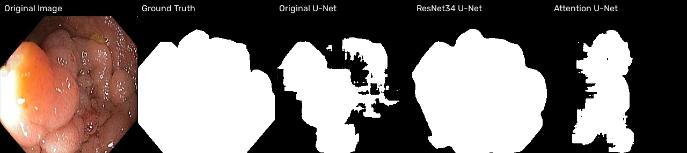

# EndoPolyp-Seg

我用 Kvasir-SEG 做了一个结肠镜息肉分割项目。给模型一张图，它会标出息肉所在的像素。我先训练了一个基础 U-Net，又试了 ResNet34 编码器和带注意力的跳跃连接，最后用 Gradio 把三个模型放到同一个页面里对照。



*从左到右依次是原图、人工标注和三种模型的预测。白色表示息肉区域。*

## 怎么跑起来

准备好 PyTorch、torchvision、OpenCV、Pillow、NumPy 和 Gradio，把三个训练好的权重放到下面的位置，再从项目根目录运行。

| 模型 | 权重路径 |
| --- | --- |
| Original U-Net | `outputs/best_unet.pth` |
| ResNet34-U-Net | `outputs_resnet34/best_unet.pth` |
| Attention U-Net | `outputs_attention/best_attention_unet.pth` |

```bash
python app.py
```

打开 [本地演示页面](http://127.0.0.1:7861)，上传一张结肠镜图像。可以选一个模型单独跑，也可以点“三模型一键对照”，切到对应页签看三个模型的预测掩码和红色叠加图。有对应的人工标注时，再上传同名 Mask，就能看到这张图的 Dice 和 IoU。

权重目前保存在本地，暂时没有公开下载链接。演示只需要权重和你要上传的图片，重跑训练或测试时再准备 Kvasir-SEG 数据集。Windows 上的启动命令、演示样例和常见问题见 [运行说明](RUNNING.md)。

## 三个模型跑得怎么样

我用同一份 150 张图的测试集比较三种模型。图像统一缩放到 256×256，预测概率达到 0.5 的像素记为前景。Dice 和 IoU 都是逐张计算再取平均。

| 模型 | 平均 Dice | 平均 IoU | 测试 Loss |
| --- | ---: | ---: | ---: |
| Original U-Net | 0.804851 | 0.718354 | 0.413240 |
| ResNet34-U-Net | **0.880280** | **0.812312** | 0.253274 |
| Attention U-Net | 0.816444 | 0.726136 | 0.406886 |

ResNet34-U-Net 在这组图上的 Dice 和 IoU 最高。Attention U-Net 的两个分数比基础 U-Net 略高，单张推理也花了更多时间。可以点开 [测试汇总](outputs_comparison/summary.csv) 或 [逐图结果](outputs_comparison/per_image_metrics.csv)，看看每张图上的差别。

我还按标注面积和位置把测试图分组，看看哪一类图更难分。分组方法和结果见 [困难样本分析](outputs_difficulty_analysis/difficulty_analysis_report.txt)。

## 推理速度

测速用的是 GTX 1060 6GB，输入 256×256，精度 FP32。Batch=1 用来看单张图要等多久，Batch=4 用来看一次处理四张图时的吞吐量。表里的端到端耗时涵盖读图、预处理、传输和模型前向，网页上的耗时显示则取预热后五次前向的中位数。

| 模型 | Batch=1 单张端到端耗时 | Batch=4 整批端到端耗时 | Batch=4 吞吐量 |
| --- | ---: | ---: | ---: |
| Original U-Net | 30.338 ms/图 | 104.236 ms/批 | 38.37 图/秒 |
| ResNet34-U-Net | **16.755 ms/图** | **39.605 ms/批** | **101.00 图/秒** |
| Attention U-Net | 32.158 ms/图 | 112.525 ms/批 | 35.55 图/秒 |

表中是稳态结果。Batch=1 去掉首批，Batch=4 也去掉最后一批只有两张图的记录。纯前向耗时、完整测试集吞吐量和显存峰值见 [Batch=1 报告](outputs_benchmark_v4_batch1/benchmark_v4_batch1_report.txt) 和 [Batch=4 报告](outputs_benchmark_v3/benchmark_v3_report.txt)。

<details>
<summary>参数量和计算量</summary>

| 模型 | 参数量 | MACs/图 | FLOPs/图 |
| --- | ---: | ---: | ---: |
| Original U-Net | 31.032 M | 54.610 G | 109.220 G |
| ResNet34-U-Net | 24.450 M | 10.393 G | 20.786 G |
| Attention U-Net | 31.382 M | 55.719 G | 111.438 G |

计算量按 256×256 单张输入统计，FLOPs 按 2 × MACs 估算。对应数据见 [Batch=1 CSV](outputs_benchmark_v4_batch1/benchmark_v4_batch1.csv) 和 [Batch=4 CSV](outputs_benchmark_v3/benchmark_v3_batch4.csv)。

</details>

## 我怎么做的

- **Original U-Net** 用四级编码器和解码器做基线。解码时用转置卷积上采样，再拼接同尺度的编码器特征。[模型代码](src/model.py)
- **ResNet34-U-Net** 把编码器换成 torchvision 的 ResNet34，用 ImageNet 权重初始化，再接上 U-Net 解码器。[模型代码](src/model_resnet.py)
- **Attention U-Net** 保留基础 U-Net 的主干，在四处跳跃连接上加 Attention Gate，先给编码器特征加权，再拼接。[模型代码](src/model_attention.py) · [Attention Gate](src/attention.py)

训练、验证、测试分别用了 **699、150、150** 对图像和标注。图像用双线性插值缩放，Mask 用最近邻插值保留标签。训练时，图像和标注一起做随机翻转和旋转。基础 U-Net 的 RGB 输入缩放到 0–1，另外两个模型再做 ImageNet 标准化。重跑现有实验时直接使用仓库里的划分文件。[数据划分](data/splits) · [预处理](src/dataset.py) · [数据增强](src/transforms.py)

三个模型都用 Adam 和 BCE + Dice Loss，按验证集 Loss 选最佳权重。基础 U-Net 和 Attention U-Net 的学习率为 `1e-4`。ResNet34-U-Net 给预训练编码器设 `1e-5`，解码器和输出层用 `1e-4`。三份最佳权重分别保存在第 84、28、89 轮。[Original 训练日志](outputs/training_history.csv) · [ResNet34 训练日志](outputs_resnet34/training_history.csv) · [Attention 训练日志](outputs_attention/attention_training_history.csv)

<details>
<summary>环境和复现实验</summary>

演示在 Windows 10、Python 3.11.18、PyTorch 2.6.0+cu124、torchvision 0.21.0+cu124、Gradio 6.32.0 下跑过。其余依赖的本机版本是 OpenCV 5.1.0.95、Pillow 13.0.0、NumPy 2.4.6、matplotlib 3.11.2、pandas 3.1.1、thop 0.1.1-2209072238。

把 Kvasir-SEG 图像和标注分别放进 `data/Kvasir-SEG/images/` 和 `data/Kvasir-SEG/masks/`，沿用 `data/splits/` 里的划分文件。现有划分共 999 对，原始数据里还有一对未纳入划分，原因待核实。Attention U-Net 的训练日志记录到第 101 轮，当前训练脚本设为 100 轮。

以下命令从项目根目录运行，会写入对应的实验输出目录。两个测速脚本需要 CUDA。

```bash
python src/train.py
python src/train_resnet.py
python src/train_attention.py

python src/compare_models.py

python src/benchmark_v4_batch1.py
python src/benchmark_v3.py
```

单独测试某个模型时，可以用对应脚本。[Original](src/test.py) · [ResNet34](src/test_resnet.py) · [Attention](src/test_attention.py)

</details>

## 仓库里有什么

- `app.py` 是 Gradio 演示入口，`src/` 里是模型、训练、测试和测速代码。
- `data/splits/` 是现有实验用的训练、验证和测试名单。
- `outputs_comparison/` 里有 [预测对照图](outputs_comparison/visualizations) 和三模型的测试结果。
- `outputs_benchmark_v4_batch1/` 和 `outputs_benchmark_v3/` 分别保存 Batch=1 和 Batch=4 的性能报告。
